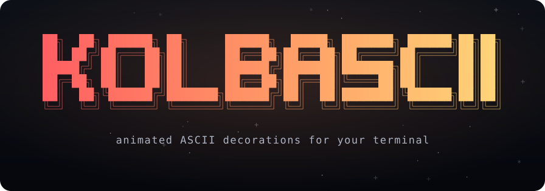
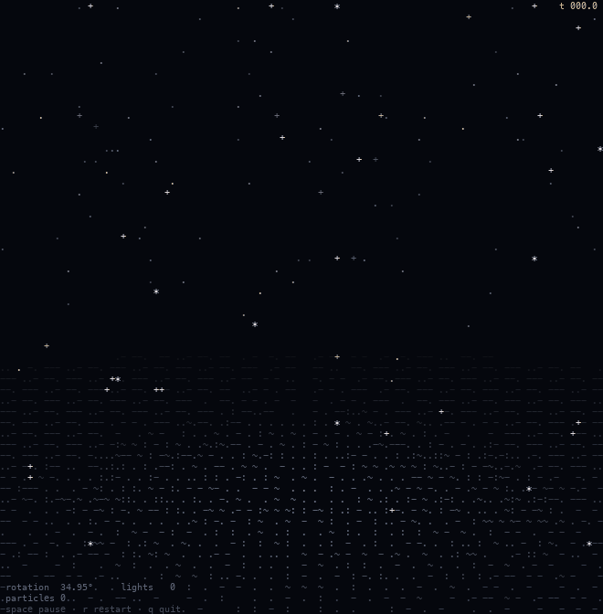
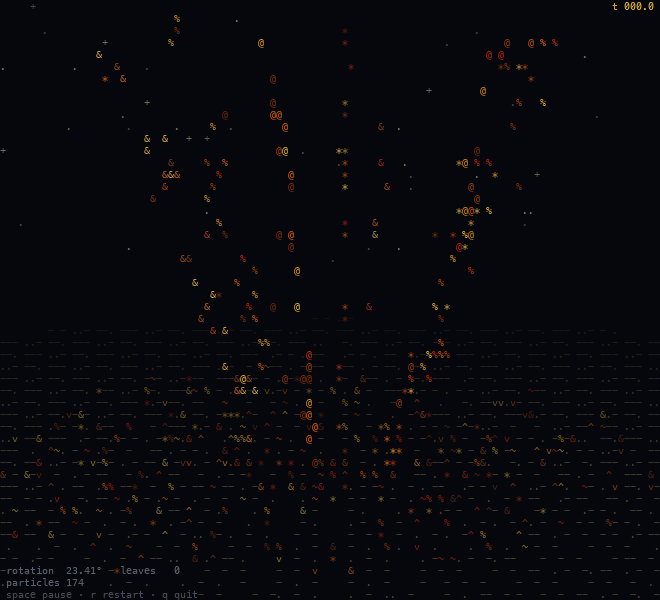
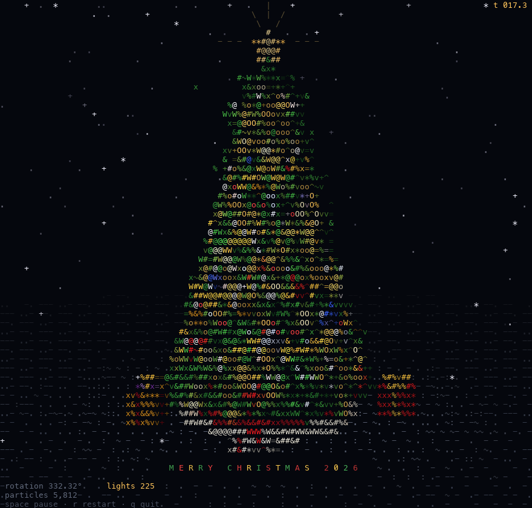
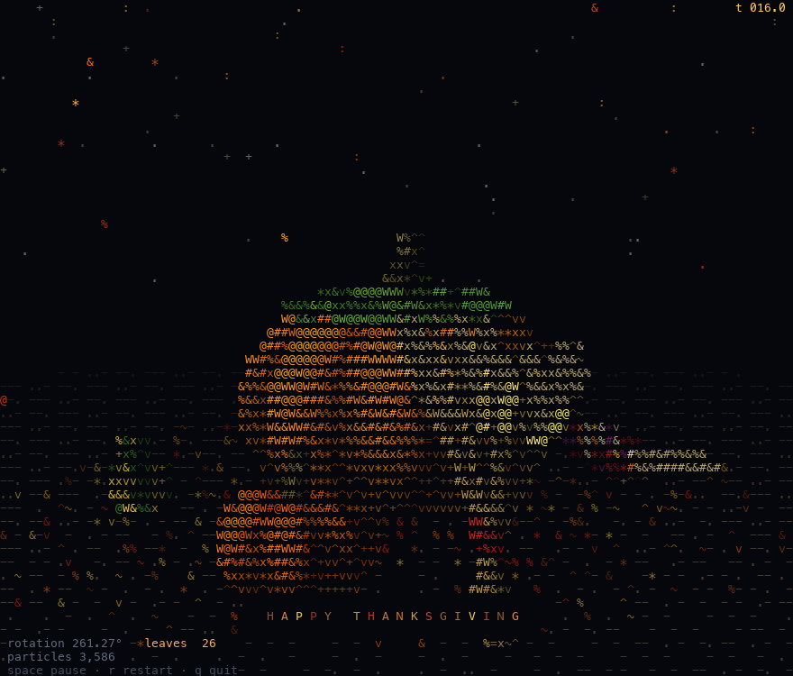
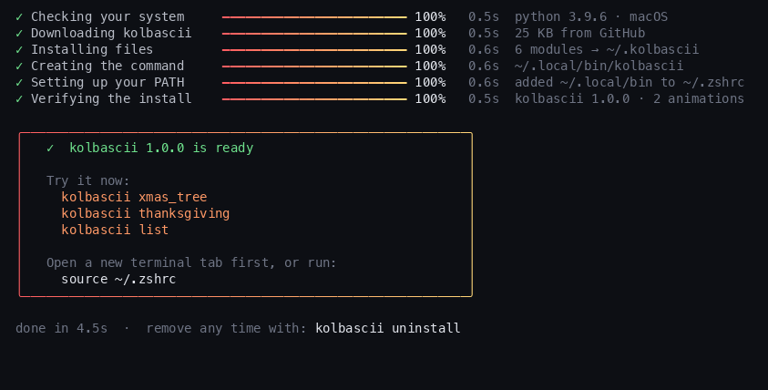

<p align="center">
  
</p>

<p align="center">
  <b>Turn any terminal window into a little 3D scene made of characters.</b><br>
  <sub>One command · no dependencies · runs right in the window you're in</sub>
</p>

<p align="center">
  
  
  
  
</p>

<br>

<table align="center">
  <tr>
    <td align="center"></td>
    <td align="center"></td>
  </tr>
  <tr>
    <td align="center"><code>kolbascii xmas_tree</code></td>
    <td align="center"><code>kolbascii thanksgiving</code></td>
  </tr>
</table>

<br>

## ⚡ Quick start

**1. Install** with one line (macOS or Linux):

```sh
curl -fsSL https://raw.githubusercontent.com/pidoshva/kolbascii/main/install.sh | bash
```

**2. Open a new terminal tab**, make the window big (full screen is best), and run:

```sh
kolbascii xmas_tree
```

| Key | While an animation plays |
| :---: | --- |
| <kbd>space</kbd> | pause / resume |
| <kbd>r</kbd> | restart from the beginning |
| <kbd>q</kbd> | quit and get your terminal back exactly as it was |

<br>

## 🎄 Animations

<table>
  <tr>
    <td width="50%" valign="top">
      
    </td>
    <td width="50%" valign="top">
      <h3><code>kolbascii xmas_tree</code></h3>
      A tall 3D spruce grows out of the snow layer by layer, then decorates itself while it slowly turns:
      <ul>
        <li>gold tinsel and a red-and-silver bead garland spiral up</li>
        <li>46 baubles with caps and shine, plus striped candy canes</li>
        <li>220 fairy lights switch on one by one, twinkling and glowing</li>
        <li>wrapped presents with ribbons and bows appear underneath</li>
        <li>a star lands with a flash, and <b>MERRY CHRISTMAS</b> types out</li>
      </ul>
      <sub>also: <code>xmas</code> · <code>christmas</code> · <code>tree</code></sub>
    </td>
  </tr>
  <tr>
    <td width="50%" valign="top">
      
    </td>
    <td width="50%" valign="top">
      <h3><code>kolbascii thanksgiving</code></h3>
      A funnel of autumn leaves spins up and winds itself into a big ribbed pumpkin, one leaf at a time:
      <ul>
        <li>the stem grows, a vine curls, two broad leaves unfold</li>
        <li>a small pumpkin, a cream one and a striped gourd pop in</li>
        <li>a cob of multicoloured corn appears kernel by kernel</li>
        <li>a tied wheat bundle grows up beside them</li>
        <li><b>HAPPY THANKSGIVING</b> types out while leaves keep falling</li>
      </ul>
      <sub>also: <code>pumpkin</code> · <code>turkey</code> · <code>harvest</code> · <code>autumn</code></sub>
    </td>
  </tr>
</table>

<br>

## 🧭 Commands

```sh
kolbascii                      # logo, help and the list of animations
kolbascii <animation>          # play it full-screen in this window
kolbascii <animation> -s 30    # stop by itself after 30 seconds
kolbascii random               # surprise me
kolbascii list                 # what's available
kolbascii update               # get the newest version and animations
kolbascii uninstall            # remove kolbascii
```

Names are forgiving: typos get a *did you mean*, and `kolbaskii` works just as well.

<br>

## 📦 The installer

<p align="center"></p>

It takes about four seconds and does six things, each with its own progress bar:

1. checks for Python 3.8+ (already there on macOS with the developer tools, and on almost every Linux)
2. downloads kolbascii into `~/.kolbascii`
3. installs the files
4. creates the `kolbascii` command in the first of `~/.local/bin`, `~/bin`, `/opt/homebrew/bin` or
   `/usr/local/bin` that is already on your `PATH` and writable without `sudo`, so it works in the
   same terminal as soon as the installer finishes
5. only if none of those qualifies: uses `~/.local/bin` and puts it on your `PATH` inside a clearly
   marked block in your shell startup file (open a new tab, or run the `source` line it prints)
6. runs the new command once to make sure it works

<details>
<summary><b>Options</b></summary>
<br>

Pass options after `bash -s --` when piping:

```sh
curl -fsSL https://raw.githubusercontent.com/pidoshva/kolbascii/main/install.sh | bash -s -- --no-modify-path
```

| Option / variable | What it does |
| --- | --- |
| `--no-modify-path` | Don't touch your shell startup file; the installer prints the `export` line to add yourself. |
| `--uninstall` | Remove everything the installer added. Same as `kolbascii uninstall`. |
| `KOLBASCII_HOME` | Where the files go. Default `~/.kolbascii`. |
| `KOLBASCII_BIN` | Where the command goes. Default: the first suitable folder already on your `PATH` (see above), else `~/.local/bin`. |
| `KOLBASCII_BRANCH` | Install from another branch. Default `main`. |
| `KOLBASCII_TARBALL` | Install from this tarball URL instead of the GitHub branch. |

From a clone, `./install.sh` installs your local copy instead of downloading.

</details>

<details>
<summary><b>Uninstall</b></summary>
<br>

```sh
kolbascii uninstall
```

Removes the files it installed in `~/.kolbascii`, its own `kolbascii` and `kolbaskii` commands
(nothing else in that folder), and the marked `PATH` block in your shell startup file.

</details>

<br>

## 🖥️ Requirements

- **macOS or Linux** (on Windows, use WSL)
- **Python 3.8+**, standard library only
- **A terminal with 24-bit colour** looks best: iTerm2, Ghostty, WezTerm, kitty, Alacritty,
  the VS Code terminal, or Terminal.app on macOS 26+. Other terminals get an automatic
  256-colour fallback.
- **A big window.** Scenes scale to whatever size you give them, and more cells means more detail.

<br>

## 🔬 How it works

<details>
<summary><b>3D, out of plain characters</b></summary>
<br>

Each scene is a cloud of thousands of 3D points: needles, pumpkin skin, ribbon, corn kernels.
Every point has a colour, a surface normal and the moment it should appear. Each frame, the
points are rotated, projected through a perspective camera, and depth-tested into the
character grid, with one z-buffer entry per cell.

Lighting chooses both the colour and the character. Brighter surfaces get denser glyphs:

```
.:-~=+^v*x%&#W@
```

so the shading comes from the characters as well as the colour. Overlay passes then add
glow around lights, the star and the greeting. Each frame goes out as a single ANSI string,
about 30 times a second.

The engine (`kolbascii/engine.py`) owns the terminal: alternate screen, hidden cursor, keys,
resizing, frame pacing, and restoring everything on exit.

</details>

<details>
<summary><b>Make your own animation</b></summary>
<br>

An animation is one Python file with a `Scene` class:

```python
# kolbascii/animations/fireworks.py
class Scene:
    def __init__(self, cols, rows):
        self.cols, self.rows = cols, rows

    def render(self, t):
        """t is seconds since start. Return (chars, colors): two flat lists of
        length cols*rows. chars[i] is one character or None, colors[i] an
        (r, g, b) tuple."""
        ...
```

Register it in `kolbascii/animations/__init__.py`:

```python
"fireworks": {
    "module": "kolbascii.animations.fireworks",
    "title": "Fireworks",
    "about": "rockets, bursts and sparkles over a skyline",
    "aliases": ("new_year", "nye"),
},
```

then try it with `python3 -m kolbascii fireworks`. `engine.Canvas` has helpers for the
greeting banner and the on-screen readout, and the two existing scenes are good templates
for 3D point clouds. Pull requests with new animations are very welcome.

</details>

<br>

<p align="center">
  <sub>MIT licensed · made for developers who like their terminals festive</sub>
</p>
